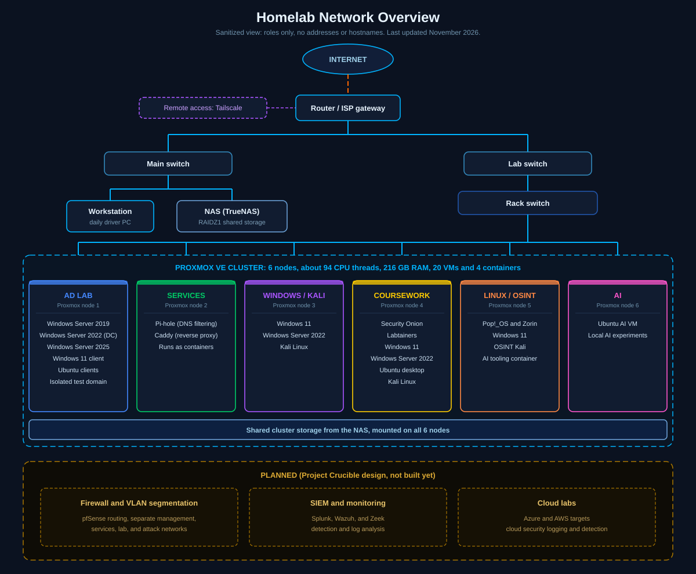

A 6-node Proxmox VE cluster I built and run at home to practice systems administration, Windows and Linux administration, and security work. Last updated: November 2026.

## At a glance
- 6 Proxmox VE nodes in one cluster, about 94 CPU threads and 216 GB RAM total
- Roughly 20 virtual machines and 4 containers
- A TrueNAS storage server (RAIDZ1) providing shared storage to every node
- Remote access through Tailscale

## Nodes and roles
- Active Directory lab: Windows Server 2019, 2022 (domain controller), and 2025, plus Windows 11 and Ubuntu clients, in an isolated test domain
- Services: Pi-hole for DNS filtering and Caddy as a reverse proxy, running in containers
- Windows and Kali: Windows 11, Windows Server 2022, and a Kali Linux VM for offensive practice
- Coursework: virtual machines for my IDS/IPS class, including Security Onion and Labtainers
- Linux and OSINT: several Linux desktop distributions, a Windows 11 VM, an OSINT-focused Kali VM, and an AI tooling container
- AI: one VM for local AI experiments

## Planned (not built yet)
Part of Project Crucible. See the project-crucible folder.
- Firewall and VLAN segmentation with pfSense
- SIEM and monitoring (Splunk, Wazuh, Zeek)
- Cloud labs in Azure and AWS

## What I learned
- Two nodes with the same CPU showed 6 cores in one place and 12 in another. The difference was physical cores versus logical threads from hyperthreading. The compute capacity was identical.

## Notes
Addresses, hostnames, and credentials are intentionally left out of this repo.
